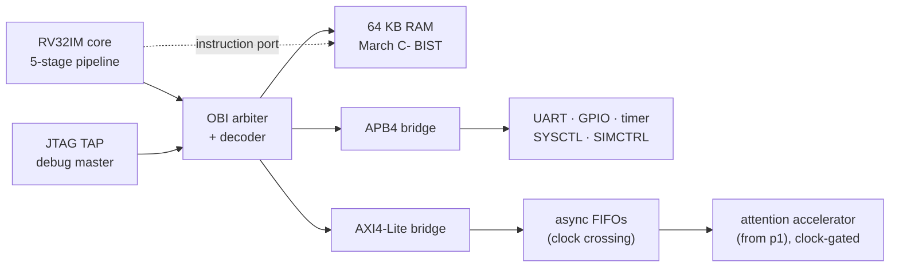
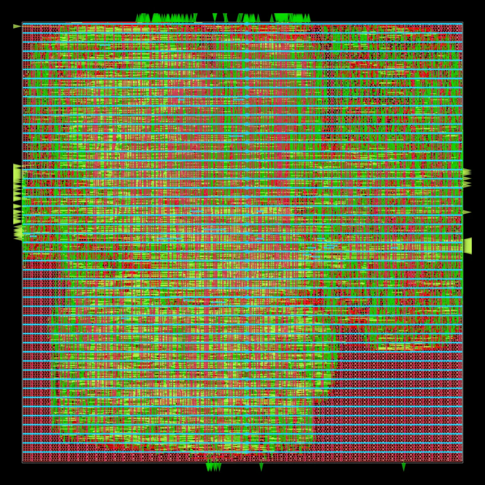
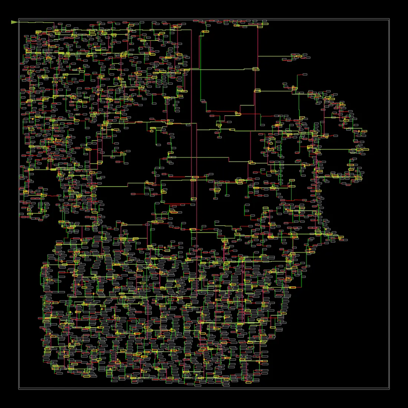

# p2-riscv-soc: a RISC-V SoC with C firmware, verified against a golden model

A small system-on-chip for the Digilent Basys 3 (Artix-7). It contains:
- a 5-stage pipelined RV32IM core with machine-mode CSRs, traps and
  interrupts;
- 64 KB of on-chip RAM;
- an OBI interconnect;
- an AMBA APB peripheral bus (UART, GPIO, timer, system control);
- the attention accelerator from p1 on AXI4-Lite, in its own clock domain;
- JTAG debug and a RAM BIST;
- C firmware built with clang.

Every instruction the RTL retires is checked against a Python
instruction-set simulator. The core is also taken through sky130 place and
route and scan insertion.

**RV32IM, 2.27 CoreMark/MHz** · **every instruction checked against an ISS** · **riscv-formal 52/52** · **sky130 core 119.8 MHz** · **98.4% scan coverage** · **Basys 3 bitstream meeting timing at 62.5 MHz (open-source flow; not yet on a board)**



| sky130 layout of the core | Clock tree |
|:---:|:---:|
|  |  |
| 25.7k cells, 0.66 x 0.66 mm, 119.8 MHz signoff, 0 DRC | 0.06 ns skew |

<sub>OpenROAD after routing and extraction. Placed and routed only; not taped out.</sub>

SYSCTL (0x1000_3000) holds the core in reset for JTAG program loading. It
also starts the RAM BIST and gates the accelerator clock (docs/spec.md
section 13).

## Results

Numbers come from runs on 2026-11-09 of the code in this repo. The logs are
under `build/` (gitignored), and each doc says how to rerun.

### Design

| | |
|---|---|
| ISA | RV32IM + Zicsr, M-mode: 11 CSR groups, 6 trap causes, timer and external interrupts. Multiply takes 4 cycles in EX, divide 34. |
| Pipeline | CPI 1.00 straight-line, 1.13 on the CRC-32 + matrix benchmark; load-use 1 stall, taken branch 2 |
| CoreMark | 2.267 CoreMark/MHz with M, 0.962 without. RTL simulation, 2 iterations; not an official score (docs/coremark.md). |
| Accelerator | p1's attention engine behind AXI4-Lite and gray-pointer async FIFOs, with clock gating (docs/spec.md sections 12-13) |
| Debug and test | JTAG TAP (IEEE 1149.1) with an OBI master behind a round-robin arbiter; core hold for program loading; March C- BIST of the 64 KB RAM |

### Verification

| | |
|---|---|
| Golden model | Python ISS, 289 pytest cases, including every M corner and deliberately broken variants that must fail |
| Lockstep, directed | 16 programs (ISA groups incl. muldiv, hello, timer interrupts, benchmark, accelerator and clock-gate tests), each at accelerator clocks of 73 and 137 MHz |
| Lockstep, random | `make rand`: 100 random programs of about 1,500 instructions, M mixed in; every retired instruction compared |
| Core tests | 53 cocotb tests, including random bus latency and interrupts during multiply/divide |
| riscv-formal | All 52 RV32IM checks pass, 0 fail (bounded model checking on the RVFI trace, free OBI memory with any grant/response timing). Covers every instruction including M, plus reg, pc_fwd, pc_bwd, unique, causal, ill and cover. Depths are 20 for instructions, 45 for divide/remainder, 15 to 25 for the consistency checks (`formal/riscv-formal/checks.cfg`). M results use riscv-formal's ALTOPS substitute functions; the arithmetic is checked by the ISS lockstep. |
| Core formal (SymbiYosys) | BMC depth 30: x0 invariant, retire order, OBI rules, forward progress, M unit progress |
| Bus, peripherals, CDC | cocotb with OBI/APB protocol checkers (SVA) and negative tests; unbounded two-clock proof of the async FIFO with four broken FIFOs caught; arbiter BMC with three seeded bugs caught |
| UVM (APB subsystem) | 11 runs pass, merged covergroup bins 337/337 (ignore_bins not counted as targets); found the UART divisor bug; three injected bugs caught |
| SoC debug | JTAG traffic while `bench` runs in lockstep, JTAG program load and boot, BIST pass and stuck-at fail, accelerator clock stopped mid-run with an unchanged result |

### Implementation

| | |
|---|---|
| sky130 place and route (core) | OpenROAD RTL-to-GDS at 10 ns: 119.8 MHz signoff, 25.7k cells, 0.43 mm^2 die, 22.5 mW; 0 DRC, antenna or slew/cap violations (pd/README.md) |
| DFT | Scan chain plus SAT-based stuck-at ATPG on the core, 98.4% of 117,684 collapsed faults with 3,881 patterns; peripherals 93.6 to 99.3%; chains verified in simulation (dft/README.md) |
| Performance model | C++ model, calibrated on directed tests. It predicts held-out programs and CoreMark within 0.6% of RTL cycles at about 70 M instructions/s (docs/perf_model.md). |
| Artix-7, Basys 3 (openXC7: yosys + nextpnr) | Full SoC with the accelerator (`ACCEL=1`) routes and meets timing: SoC clock 65.3 MHz post-route against 62.5 MHz, accelerator 72.9 MHz against 50 MHz, JTAG 189 MHz against 12 MHz. Uses 15.3k LUTs (74% of the XC7A35T), 8.7k FFs, 72 of 90 DSP48 (the 16 MAC multipliers are mapped to LUTs; with all 88 in DSPs the route did not converge), 16 RAMB36 + 6 RAMB18. Without the accelerator: 5.1k LUTs, 65.5 MHz. Bitstreams written. nextpnr places on the XC7A50T die that the 35T shares, so whether the bitstream stays inside the 35T's usable area is checked only by a Vivado build (`ACCEL=1 vivado -mode batch -source fpga/build.tcl`, not yet run). |

Not done: running on the board. That needs Vivado, and `fpga/build.tcl` is
ready. The FPGA-only parts (BSCANE2 JTAG, BUFGCE clock gate) are linted and
elaborated against the Xilinx cell library but not simulated. Nothing here
is taped out.

## Run it

Tools:
- Verilator, Yosys and SymbiYosys (OSS CAD Suite);
- Verible, cocotb, and a RISC-V clang (lowRISC toolchain in `~/tools/riscv`);
- for `pd/` and `dft/`, Docker with the `openroad/orfs` and
  `ghcr.io/aucohl/fault` images;
- for `formal/riscv-formal/`, a clone of YosysHQ/riscv-formal.

```
make sw       # build ISA tests and C programs, run each on the ISS
make model    # ISS unit tests
make core     # core tests, lint, formal
make periph   # bus/peripheral tests, protocol-checker negatives, formal
make soc      # full SoC vs the ISS on every program
make rand N=100
make socdbg   # JTAG / core hold / BIST / clock gate: lint, latch check, formal, SoC tests
make -C sw coremark            # then see docs/coremark.md
make perf                      # C++ model, refit and compare against the RTL
make dft                       # scan chain + ATPG for the peripherals and the core
bash pd/run_orfs.sh rv32_core  # place and route
bash formal/riscv-formal/run.sh -j8
```

## Layout

```
rtl/core/    rv32_core: fetch, decoder, ALU, multiply/divide, regfile, CSRs, hazard unit
rtl/bus/     OBI decoder, 2-master arbiter, OBI-to-APB and OBI-to-AXI4-Lite bridges, checkers
rtl/periph/  UART, GPIO, timer, system control (SYSCTL), simulation control
rtl/mem/     dual-port RAM (BRAM template)
rtl/accel/   attention accelerator (from p1) as an AXI4-Lite peripheral
rtl/debug/   JTAG TAP and debug transport (OBI master)
rtl/dft/     March C- memory BIST, RAM port mux
rtl/clk/     clock gate (sky130 ICG cell, BUFGCE, or behavioral model)
rtl/soc.f    SoC source list outside rtl/core (used by every flow)
model/       instruction-set simulator, random program generator, perf/ (C++ model)
sw/          crt0, linker script, drivers, ISA tests, C programs, CoreMark port
third_party/ CoreMark sources (EEMBC, see docs/coremark.md)
tb/          core/, periph/, soc/ (lockstep), accel/, debug/, dft/, socdbg/, uvm/
formal/      SymbiYosys setups, riscv-formal wrapper
pd/          OpenROAD place and route
dft/         scan insertion and ATPG
synth/       sky130 synthesis + STA, Artix-7 resource count
fpga/        Basys 3 top, constraints, Vivado and openXC7 build scripts
docs/        spec.md (the contract between blocks), coremark.md, perf_model.md
```
