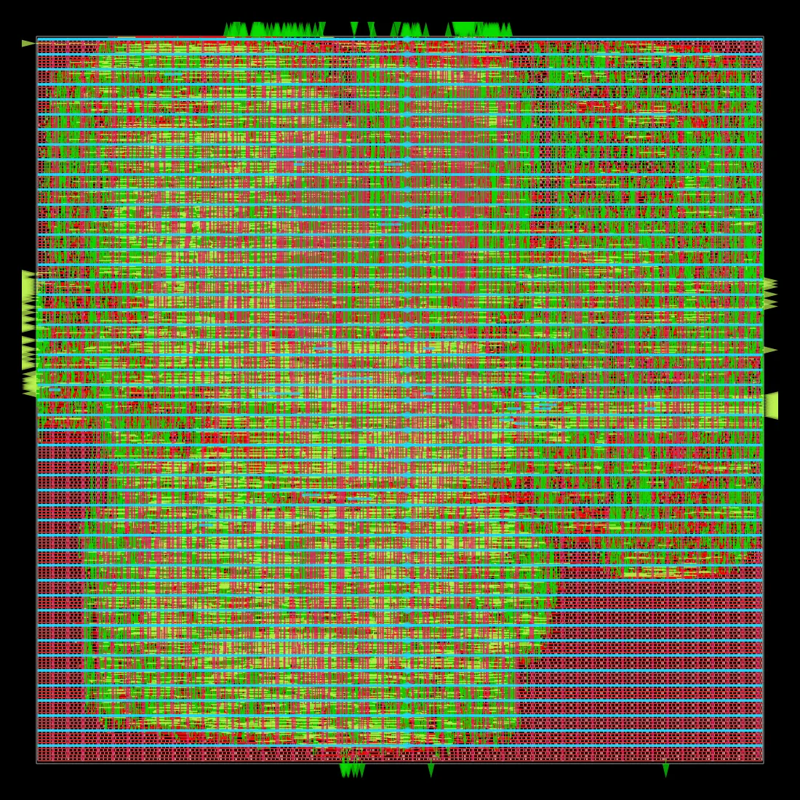
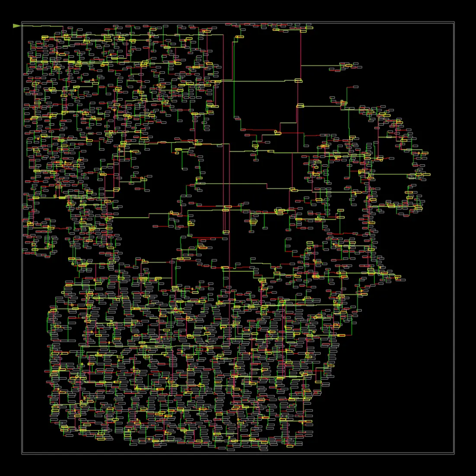

# Physical design (OpenROAD-flow-scripts, sky130hd)

`bash pd/run_orfs.sh <design>` runs the full RTL-to-GDS flow on one block in
the `openroad/orfs` Docker image:
- yosys synthesis;
- floorplan and power grid;
- global and detailed placement;
- clock-tree synthesis;
- global and detailed routing;
- parasitic extraction;
- signoff STA;
- the final GDS.

The repo is copied into the container, and results come back to
`build/orfs/<design>/`:
- `reports/.../metadata.json` holds the numbers below;
- `6_finish.rpt` holds timing and power;
- `results/.../6_final.gds` is the layout.

The script needs Docker. It uses `docker` if that reaches a daemon,
otherwise Docker Desktop's CLI from WSL.

## rv32_core

`pd/rv32_core/rv32_core_pd.sv` is the core as it sits in `soc_top`. The
RVFI trace port is left open, so the trace-only logic is removed.

| Setting | Value |
|---|---|
| Clock | 10 ns |
| I/O delay | 20% of the period on each side of the core boundary |
| Core utilization | 40% |
| Slew/cap repair margin | 20% |

Results for the RV32IM + Zicsr core, 2026-11-09:

| Metric | Result |
|---|---|
| Setup WNS / TNS | +1.65 ns / 0 |
| Signoff Fmax | 119.8 MHz |
| Hold WNS | +0.45 ns |
| Clock skew | 0.06 ns |
| Std cells | 25,657 (190,031 um^2), 44% utilization |
| Die | 433,175 um^2 (about 0.66 x 0.66 mm) |
| Detailed-route DRC errors | 0 |
| Antenna violations | 0 |
| Max slew / cap / fanout violations | 0 / 0 / 0 |
| Power (tt corner, default activity) | 22.5 mW |
| GDS | written (`6_final.gds`) |

| Placement and routing | Clock tree |
|---|---|
|  |  |

The earlier RV32I core (before the M extension) routed at 115.8 MHz with
17,555 cells and 18.7 mW.

These are OpenROAD signoff numbers at the typical corner, after routing and
parasitic extraction. The design was not taped out, and there is no
silicon measurement. Power uses the tool's default switching activity, not
a simulation trace.
